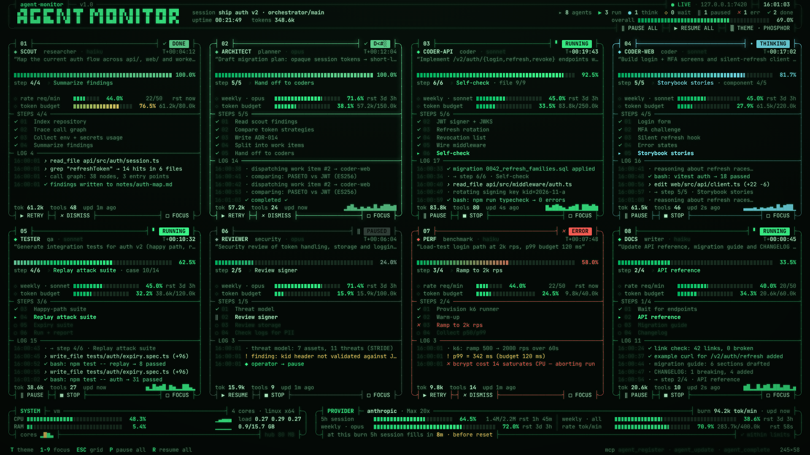
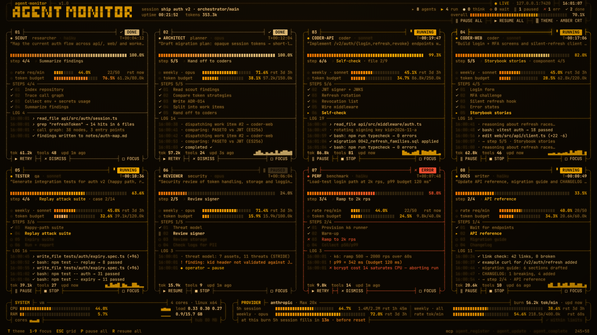
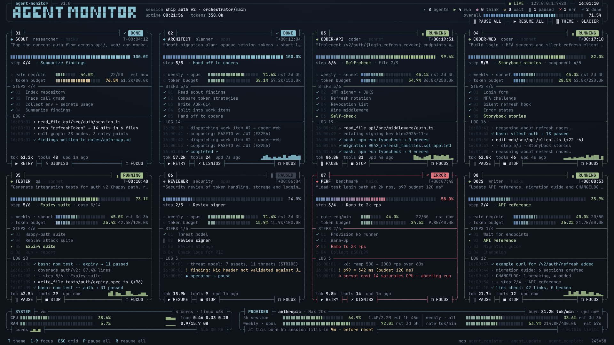
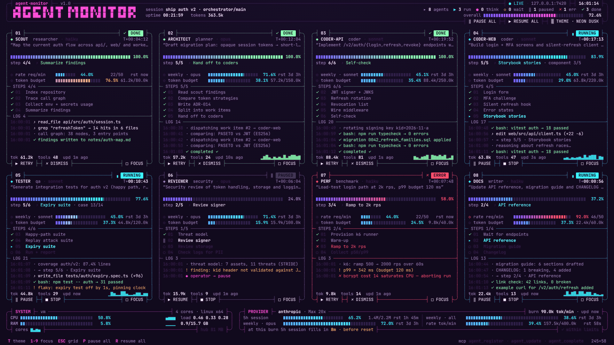
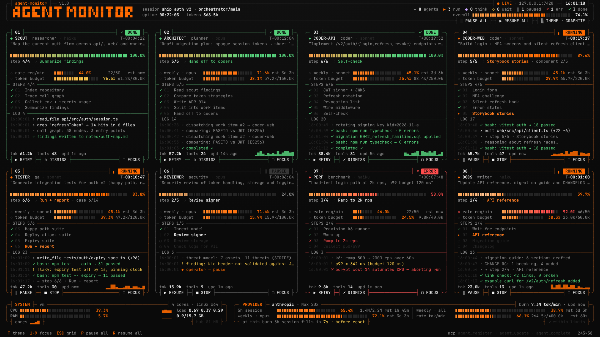
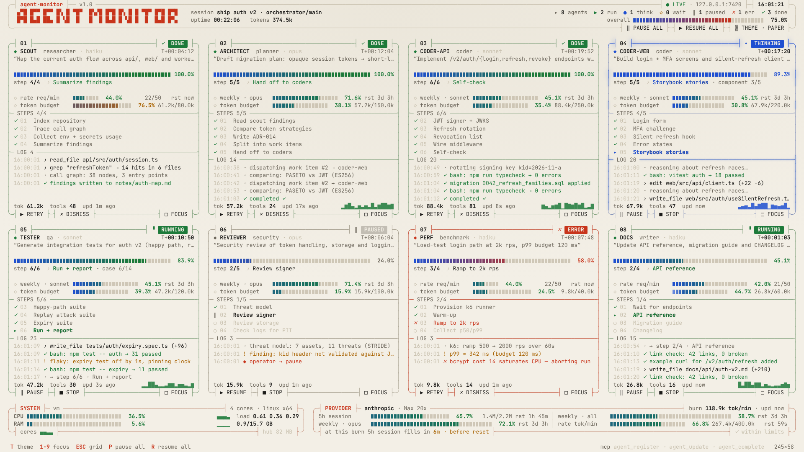

# MCP Agent Monitor

Terminalden çalışan AI uygulamanızın başlattığı **alt agent'ları** tek ekranda,
yuvarlatılmış köşeli ASCII panellerle canlı izleyin. Ekran, o anda kaç alt
agent çalışıyorsa o kadar panele kendiliğinden bölünür. Durum, yüzde, adım,
süre ve log bilgileri **MCP** üzerinden güncellenir. Panellerdeki butonlarla
(PAUSE / STOP / RESUME / RETRY) agent'lara komut gönderebilirsiniz.



## Hızlı başlangıç

```bash
npm install
npm run demo        # sahte verilerle demo → http://127.0.0.1:7420
npm start           # sadece dashboard hub'ı (gerçek kullanım)
```

Sunucu olmadan da açılır: `public/index.html?demo` tarayıcı içi simülasyonla
çalışır.

### Claude Code / herhangi bir MCP istemcisine bağlama

Repo kökündeki `.mcp.json` hazır gelir:

```json
{ "mcpServers": { "agent-monitor": { "command": "node", "args": ["src/mcp.js"] } } }
```

MCP sunucusu açılınca çalışan bir hub arar. Bulamazsa hub'ı kendi içinde
başlatır, böylece dashboard her zaman `http://127.0.0.1:7420` adresinde olur.
Port için `AGENT_MONITOR_PORT`, uzak hub için `AGENT_MONITOR_URL` kullanılır.

Orkestratör agent'ın nasıl rapor vereceği
[`.claude/skills/agent-monitor/SKILL.md`](.claude/skills/agent-monitor/SKILL.md)
içinde anlatılıyor. Claude Code bu skill'i otomatik olarak yükler.

## MCP araçları

| araç | ne yapar |
| --- | --- |
| `monitor_open` | dashboard URL'ini döner |
| `monitor_set_session {title}` | başlıktaki oturum adını ayarlar |
| `agent_register {id, name, role, model?, task, steps[], status?}` | yeni panel açar |
| `agent_update {id, status?, progress?, step?, stepLabel?, message?, level?, tokensDelta?, metrics?}` | durum, yüzde, adım ve log günceller; bekleyen operatör komutunu `control` alanında döner |
| `agent_log {id, message, level?}` | log satırı ekler |
| `agent_complete {id, success, message?}` | `done` ya da `error` olarak bitirir |
| `agent_check_control {id}` | bekleyen pause/stop/resume/retry komutunu okur ve tüketir |
| `provider_usage_set {provider, plan, limits[]}` | alt kutudaki PROVIDER panelini (plan, 5 saatlik pencere, haftalık limit, rate limit) günceller |
| `provider_usage_get` · `system_stats` | limit durumu · makinenin CPU/RAM bilgisi |
| `agent_list`, `agent_remove {id}`, `monitor_reset` | listeleme ve temizlik |

Her agent'ın **kendi limitleri** kendi panelinde ayrı görünür:
`agent_register`/`agent_update` çağrısına `tokenBudget: 120000` (token
bütçesi, `tokensDelta` ile otomatik dolar) ve `limits: [{id, label, used,
limit, unit, resetsAt}]` (ör. agent'ın çalıştığı modelin haftalık limiti)
eklenir.

Ekranın altında iki kutu var. **SYSTEM** kutusu CPU ve RAM'i (meter, geçmiş
grafiği, load average, çekirdek başına ısı şeridi) gösterir; değerleri hub
saniyede bir işletim sisteminden okur. **PROVIDER** kutusu sağlayıcı
limitlerini, reset sürelerini, dakikalık token harcamasını ve "bu hızla 5h
penceresi X dakikada dolar" tahminini gösterir.

Durumlar: `queued · running · thinking · waiting · paused · error · done · stopped`.
`T+hh:mm:ss` sayacı yalnızca aktif durumlarda (running, thinking, waiting) ilerler.

## REST / SSE (MCP dışı entegrasyon için)

```
GET    /api/state                 tüm durum
GET    /api/events                Server-Sent Events akışı
POST   /api/agents                register
PATCH  /api/agents/:id            update
POST   /api/agents/:id/log        {message, level}
POST   /api/agents/:id/control    {action: pause|resume|stop|retry}
DELETE /api/agents/:id
```

## Temalar

Başlıktaki `THEME` butonu ya da `T` tuşuyla değişir. Seçim tarayıcıda
hatırlanır. URL'den de seçilebilir: `?theme=amber`.

| | |
| --- | --- |
|  **Phosphor** |  **Amber CRT** |
|  **Glacier** |  **Neon Dusk** |
|  **Graphite** |  **Paper** |

## Klavye

`T` tema · `1–9` paneli büyüt · `ESC` grid'e dön · `P` hepsini durdur · `R` hepsini sürdür

## Nasıl çiziliyor

- Ekran karakter ızgarasına bölünür (`CW × LH` piksel ölçülür). Her panel tam
  hücrelerden oluşan bir dikdörtgendir ve her satır tam `w` hücre genişliğindedir.
  Bu yüzden çerçeveler her çözünürlükte hizalı kalır.
- Uzun karakter dizileri kesin hücre genişliğine sabitlenir, böylece alt-piksel
  yuvarlama ızgarayı kaydıramaz.
- Dikey kutu karakterleri satır aralığını kapatacak şekilde uzatılır.
  Yuvarlak köşeler (`╭╮╰╯`) iki hücreye yayılan CSS yaylarıyla çizilir;
  `─` glifinin gerçek konumu çalışma anında ölçüldüğü için çizgiler tam birleşir.
- İlerleme çubuğu, hücre başına bir segmentten oluşan ve kesintisiz dolan bir meter'dır.
- Animasyonlar Emil Kowalski'nin arayüz hareket ilkelerine göre yapıldı:
  özel ease-out eğrileri, 150–500 ms süreler, yalnızca `transform`, `opacity`,
  `clip-path` ve `filter`, basınca `scale(.96)`, yalnızca gerçek hover'ı olan
  cihazlarda hover efekti, kademeli giriş animasyonları, yerleşim
  değişimlerinde FLIP, durum değişince harf karıştırma efekti, tema geçişinde
  View Transition ve `prefers-reduced-motion` desteği.

## Scriptler

```bash
node scripts/smoke.mjs                 # MCP uçtan uca test
node scripts/screenshots.mjs [url] [dir] [scale]
node scripts/record.mjs [url] [dir]    # etkileşim videosu
```
